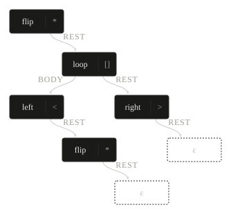
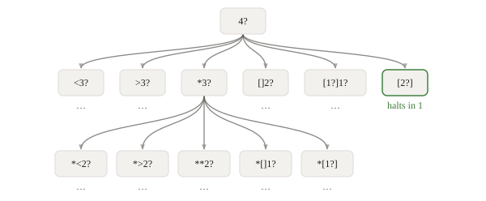

*John Martin, Satan Presiding at the Infernal Council (1824).*

This article is part of my contribution to [bbchallenge](https://bbchallenge.org/) — a project dedicated to determining values of the [Busy Beaver](https://en.wikipedia.org/wiki/Busy_beaver) function, the largest number of steps a machine of a given size can take before it halts.[^1] Instead of [Turing machines](https://en.wikipedia.org/wiki/Turing_machine), I look at the same problem for a [binary tape machine with loops](https://wiki.bbchallenge.org/wiki/Boolfuck). The goal is to find the longest-running halting program of each length $n$ and prove that no other program of length $n$ halts after more steps.

## The Busy Beaver problem

One of the most famous results in theoretical computer science is that no general algorithm can decide whether an arbitrary program halts. Because of that, each halting question can be a problem of its own, demanding its own proof. Computing $\mathrm{BB}(n)$ means settling that question for every program of size $n$ at once: running the ones that stop to find the record, and proving that all the rest run forever.

In 2024, the bbchallenge community settled the five-state Turing machine case — $\mathrm{BB}(5) = 47{,}176{,}870$ — with a machine-checked proof in Coq ([Coq-BB5](https://github.com/ccz181078/Coq-BB5)). The methods developed for that proof are adapted here to a binary tape machine.

## The language

The machine operates on a bi-infinite tape of bits, all initially `0`, with a read/write head. A program is a string over five characters — three primitive commands and a loop:

| Command | Effect                                                      |
| ------- | ----------------------------------------------------------- |
| `<`     | move the head one cell left                                 |
| `>`     | move the head one cell right                                |
| `*`     | flip the bit under the head                                 |
| `[b]`   | if the current bit is `1`, run `b` and repeat; if `0`, skip |


*Running `*<*[>]` (the 6-character champion) from a blank tape: eight steps from start to halt.*

This machine [is Turing-complete](https://esolangs.org/wiki/Boolfuck#Computational_class) — capable of any computation — so its Busy Beaver function is just as uncomputable as the classical one. Running a program charges one step for each `<`, `>`, `*`, and `[` check.[^2]

## Formalisation

Proving a Busy Beaver value takes not only clever arguments, but massive computer search — so we need to prove not just our theorems, but the correctness of the programs running that search. That is what [proof assistants](https://en.wikipedia.org/wiki/Proof_assistant) are built for: languages where you write both the code and a proof of its soundness, verified by the computer itself. This project uses [Lean 4](https://lean-lang.org/).

### Language formalisation

Rather than storing programs as raw strings, a program is an inductive type:[^3]

```lean
inductive Program where
  | nil
  | left  (rest : Program)
  | right (rest : Program)
  | flip  (rest : Program)
  | loop  (body rest : Program)
  | gap   (size : Nat) (pos : 0 < size) (rest : Program)
```

Each constructor corresponds to one command, `nil` (written `ε`) is the empty program, and `gap` (written `ωn`) is a placeholder for an unfinished piece of a fixed, positive size $n$.[^4] Later we will write `‖p‖` for the length of `p` in characters, and `p°` to mean that `p` contains no gaps.


*The program `*[<*]>` as a `Program` tree. Each `loop` branches into its `body` (inside the brackets) and its `rest` (after them).*

### Tape formalisation

Rather than describing the tape by a concrete data structure, we specify it by its properties in a typeclass:[^5]

```lean
class Tape (T : Type) where
  cells       : T → Int → Bool
  blank       : T
  flip        : T → T
  moveL       : T → T
  moveR       : T → T
  cells_blank : ∀ i, cells blank i = false
  cells_flip  : ∀ t i, cells (flip t) i =
                  if i = 0 then !cells t 0 else cells t i
  cells_moveL : ∀ t i, cells (moveL t) i = cells t (i - 1)
  cells_moveR : ∀ t i, cells (moveR t) i = cells t (i + 1)
```

Here `cells` views the tape relative to the head: `0` is the bit under the head, positive indices lie to the right, and negative indices to the left. `flip`, `moveL`, and `moveR` correspond directly to `*`, `<`, and `>`.

### Execution

A machine pairs a tape with the (remaining part of a) program. One step executes the current command or stops:[^6]

```lean
def step : Machine T → Option (Machine T)
  | ⟨_, ε⟩          => none
  | ⟨t, .left p⟩    => some ⟨Tape.moveL t, p⟩
  | ⟨t, .right p⟩   => some ⟨Tape.moveR t, p⟩
  | ⟨t, .flip p⟩    => some ⟨Tape.flip t, p⟩
  | ⟨t, .loop b p⟩  => some ⟨t, if Tape.cells t 0 then b ++ .loop b p else p⟩
  | ⟨_, .gap _ _ _⟩ => none
```

We write `m⇒` for a single step and `m ⇒ k` for `k` steps in a row:[^7]

```lean
def steps (m : Machine T) : Nat → Option (Machine T)
  | 0     => some m
  | n + 1 => m⇒.bind (·.steps n)
```

### Halting and divergence

From `steps` we define halting in `k` steps, halting, and divergence:

```lean
def HaltsIn  (m : Machine T) (k : Nat) : Prop := ∃ t, m ⇒ k = some ⟨t, ε⟩
def Halts    (m : Machine T) : Prop           := ∃ k, HaltsIn m k
def Diverges (m : Machine T) : Prop           := ∀ k, (m ⇒ k).isSome
```

A machine halts in `k` steps when its program reaches `ε` after exactly `k` steps, and diverges when it can still take a step after any number of steps `k`. We denote these as `m ⇓ k`, `m⇓`, and `m⇑`, and use the same notation `p ⇓ k`, `p⇓`, and `p⇑` for a program `p` run from a blank tape. Later we will write `p ≼ q` when `q` halts in at least as many steps as `p` (`∀ k, p ⇓ k → ∃ k' ≥ k, q ⇓ k'`).

### The Busy Beaver statement

Writing `ℒ n` for the set of gap-free programs of length `n`, the entire Busy Beaver claim reduces to two lines:

```lean
structure IsBB (n v : Nat) : Prop where
  upper : ∀ (p : ℒ n) (k : Nat), p ⇓ k → k ≤ v
  lower : ∃ (p : ℒ n),           p ⇓ v
```

Here `IsBB n v` states that $\mathrm{BB}(n) = v$: no program of length `n` halts in more than `v` steps, and at least one halts in exactly `v` steps.

## Tree Normal Form

There are $|\mathcal{L}(14)| = 304{,}036{,}170$ programs of length 14, and their number more than quadruples with each extra character. Reasoning about each program individually is neither feasible, nor elegant, nor even necessary. For example, every program of the form `[ω12]` behaves identically: on a blank tape the current bit is `0`, so the loop body is never entered and all 14,878,455 programs halt in a single step.

We therefore expand a gap only when its contents actually affect execution; whenever we prove something about a program with gaps, the same proof holds for every program that fits it. This strategy is known as *Tree Normal Form* (TNF): start from a single gap `ωn`, reason about it, and branch only when we hit a gap.

### Refinement

A program with gaps represents a family of programs. We write `p ⊑ q` when `p` refines `q` by filling in some[^8] of its gaps with programs of matching size:[^9]

```lean
inductive Refines : Program → Program → Prop
  | nil   : Refines ε ε
  | left  {p q : Program} : Refines p q → Refines (.left p) (.left q)
  | right {p q : Program} : Refines p q → Refines (.right p) (.right q)
  | flip  {p q : Program} : Refines p q → Refines (.flip p) (.flip q)
  | loop  {b' b p q : Program} :
      Refines b' b → Refines p q → Refines (.loop b' p) (.loop b q)
  | gap   {k : Nat} {h : 0 < k} {s p q : Program} :
      ‖s‖ = k → Refines p q → Refines (s ++ p) (.gap k h q)
```

Although `⊑` is purely syntactic, it can be proved that:

```lean
theorem haltsIn  {p q : Program} {k : Nat} : p ⊑ q → (q ⇓ k) → (p ⇓ k)
theorem halts    {p q : Program}           : p ⊑ q → q⇓ → p⇓
theorem diverges {p q : Program}           : p ⊑ q → q⇑ → p⇑
```

In other words, halting and divergence propagate from a general program to every refinement of it.

### Expanding a gap

When we cannot settle a partial program `q` as a whole, we split the family it represents into smaller subsets and reason about each of them separately. An `Expander` pairs such a splitting function with proofs that no halting time is lost,[^10] that expansion terminates,[^11] and that it only fills gaps, keeping the length:

```lean
structure Expander where
  expand     : (q : Program) → Fin q.numGaps → List Program
  cover      : ∀ {p q : Program} (i : Fin q.numGaps),
    p° → p ⊑ q → ∃ c ∈ expand q i, ∃ p', p'° ∧ p' ⊑ c ∧ p ≼ p'
  decreasing : ∀ {q c : Program} {i : Fin q.numGaps},
    c ∈ expand q i → ‖c‖° < ‖q‖°
  size       : ∀ {q c : Program} {i : Fin q.numGaps},
    c ∈ expand q i → ‖c‖ = ‖q‖
```

The simplest way to expand a gap is to branch on its first command: a move, a flip, or a loop.[^12]


*Expanding `ω4` one command at a time. `[ω2]` halts in a single step, whatever its body.*

## Deciders

To draw any conclusion about a partial program — that it halts, that it never does, or that nothing can be said until one of its gaps is filled — we need a *decider*. Its conclusion is a `Verdict`:

```lean
inductive Verdict (q : Program) where
  | halts    (steps : Nat) (h : q ⇓ steps)
  | diverges (h : q⇑)
  | stuck    (gap : Fin q.numGaps)
  | unknown
```

`halts t h` and `diverges h` carry proofs that the program halts after exactly `t` steps or never halts, whatever fills its gaps. `stuck i` means that reasoning about the program cannot go on until gap `i` is expanded. `unknown` is an honest admission that the decider found neither a proof nor a gap to blame.

A decider is just a function that takes a program and returns its verdict:

```lean
def Decider := (q : Program) → Verdict q
```

For example, a decider may simply run the program for a few hundred steps and see whether it halts, look for a configuration that repeats itself, possibly shifted along the tape, or recognise patterns on the tape that keep growing in a predictable way. Each of them settles some programs and gives up on the rest.

Since different deciders settle different programs, we need to combine their conclusions about the same program. `Verdict q` forms a [monoid](https://en.wikipedia.org/wiki/Monoid) with `unknown` as the identity: concatenation keeps the first verdict that is not `unknown`.

Functions into a monoid form a monoid pointwise, so deciders inherit it, and concatenation chains them into a single decider.[^13]

## Search

An expander and a decider are all the search needs. It asks the decider about a partial program and, whenever the decider gets stuck on a gap, expands that gap and recurses into the children:[^14]

```lean
def search (e : Expander) (d : Decider) (q : Program) : Outcome :=
  match d q with
  | .halts t _  => ⟨[], some (t, q)⟩
  | .diverges _ => ∅
  | .stuck i    =>
    .concat ((e.expand q i).attach.map fun c => search e d c.1)
  | .unknown    => ⟨[q], none⟩
termination_by ‖q‖°
decreasing_by exact e.decreasing c.2
```

It always terminates, since every recursive call has a strictly smaller `‖q‖°`. The result is an `Outcome`: the *holdouts*, programs the decider could not settle, and the longest halt found together with the program that achieves it:

```lean
structure Outcome where
  holdouts : List Program
  longest  : Option (Nat × Program)
```

Outcomes of the children form yet another monoid: holdouts are concatenated, and the longer halt is kept.

If a search from `ωn` leaves no holdouts, its longest halt is exactly $\mathrm{BB}(n)$:

```lean
theorem IsBB.of_search (e : Expander) (d : Decider) {n B : Nat} :
    (search e d (ω n)).value? = some B → IsBB n B
```

Every program of length `n` refines `ωn`, so it either runs forever or halts within `B` steps. And the program that achieves `B` is a partial program of length `n` that halts in `B` steps, so filling its gaps with anything gives a gap-free one that does too.

With `fullChain` concatenating nine deciders, the whole proof that $\mathrm{BB}(14) = 158$ fits in a line:

```lean
theorem bb14 : IsBB 14 158 :=
  IsBB.of_search .tnf fullChain (by native_decide)
```

## Conclusion

Any other value up to length 14 is proved the same way. Here they all are, together with the number of programs of each length and one of its champions:[^15]

| $n$ |    Programs | $\mathrm{BB}(n)$ | Champion          |
| --- | ----------: | ---------------: | ----------------- |
| 1   |           3 |                1 | `<`               |
| 2   |          10 |                2 | `<<`              |
| 3   |          36 |                3 | `<<<`             |
| 4   |         137 |                4 | `<<<<`            |
| 5   |         543 |                5 | `<<<<<`           |
| 6   |       2,219 |                8 | `*<*[>]`          |
| 7   |       9,285 |               10 | `*<*[*>]`         |
| 8   |      39,587 |               14 | `*[<*<*>]`        |
| 9   |     171,369 |               18 | `*[[<]>>*]`       |
| 10  |     751,236 |               30 | `*[<*[>]<<]`      |
| 11  |   3,328,218 |               35 | `*[<*[>]*<<]`     |
| 12  |  14,878,455 |               72 | `*[<*[>>*>]<]`    |
| 13  |  67,030,785 |              120 | `*[<*<*[>*>]<]`   |
| 14  | 304,036,170 |              158 | `*[<<*[>>>*>]<]`  |

All of these values come from the same search: the effort goes into a few general deciders, each proved sound once.
The full Lean 4 formalisation is available at [github.com/rlwq/BBBTape](https://github.com/rlwq/BBBTape).

[^1]: Non-halting machines are not counted — otherwise the answer would trivially be infinite. Separating them from machines that merely run for a very long time is what makes the function [uncomputable](https://en.wikipedia.org/wiki/Halting_problem).
[^2]: Both `[` and `]` can be thought of as a single operation — a conditional jump — so their cost is always 1 step regardless of the outcome.
[^3]: An inductive type avoids scanning for matching brackets at runtime and guarantees that every program is syntactically valid by construction.
[^4]: In Lean, `ω n` — a wildcard standing for any valid program of length $n$. Later, gaps let us reason about whole classes of programs at once rather than enumerating them one by one.
[^5]: Separating the interface from the implementation lets us define the machine once and pick whichever tape fits the task — a plain function `Int → Bool` for clean algebraic proofs and the final specification, or a fast list zipper for running simulations and deciders.
[^6]: Hitting `.gap` also returns `none`: the next command is unknown, so execution cannot continue — though unlike `ε`, it does not count as halting.
[^7]: `Option.bind` composes steps [monadically](https://en.wikipedia.org/wiki/Monad_(functional_programming)): if any intermediate step returns `none`, the rest of the chain short-circuits to `none`.
[^8]: Possibly none — refinement is reflexive, so every program refines itself (`p ⊑ p`).
[^9]: The replacement programs may themselves contain gaps — for instance, `*[ω2] ⊑ ω1[ω2]`.
[^10]: Allowing `p ≼ p'` instead of `p = p'` lets the expander drop entire branches, as long as every dropped program is matched or exceeded in halting time by one among the remaining children. For example, swapping every `<` with `>` gives an equivalent program by symmetry, and any program that does not start with `*` can move its leading steps on the blank tape to the end — so only programs starting with `*` (and `<<<...<`) need to be searched.
[^11]: `decreasing` guarantees that expansion cannot go on forever: every child is strictly less unknown than its parent, measured by `‖c‖°`, the total size of its gaps (so `c°` means `‖c‖° = 0`).
[^12]: The expander actually used in the code is considerably more involved — for instance, it skips mirrored programs.
[^13]: `stuck` ends the chain as well: a program whose execution reaches a gap neither halts nor runs forever, so no other decider could settle it.
[^14]: `attach` pairs each child with a proof that it came from `expand`, so that `decreasing_by` can use `decreasing` on it.
[^15]: Champions are not unique: for example, for $n \le 5$, any program without loops takes exactly $n$ steps, and mirroring a champion always gives another one.
