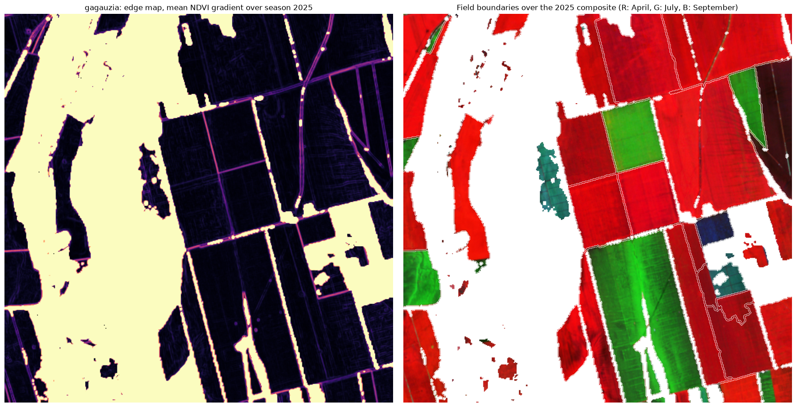
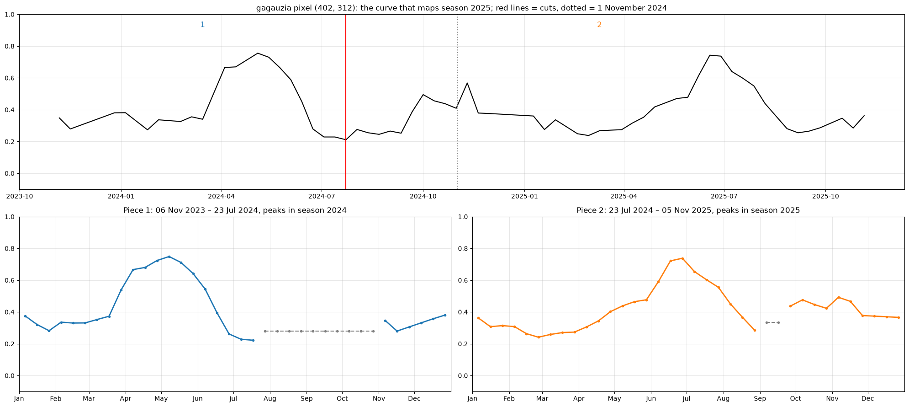
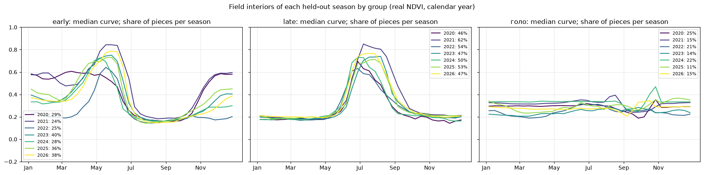
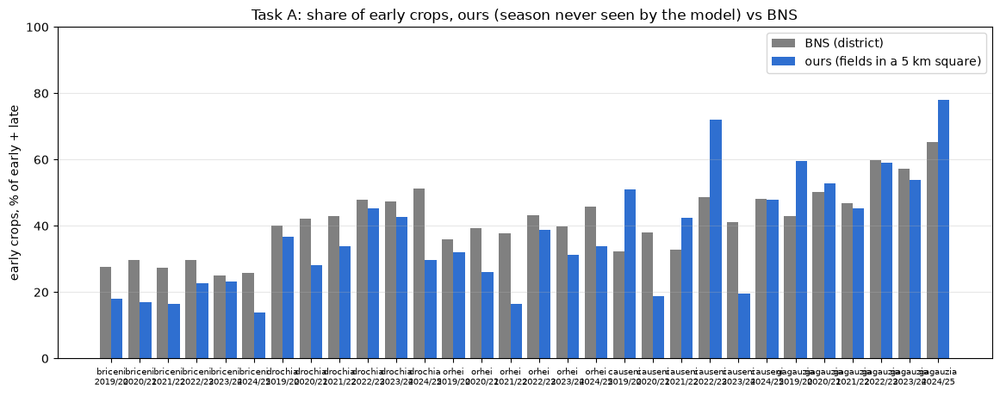

I want to tell, from satellite images, what grows on every field in Moldova: wheat, rapeseed, sunflower or maize. There are no labelled fields to learn from — only the official statistics of sown area per district. So the first step is modest: split all cropland into **early** crops, **late** crops and **bare**, then check whether the shares agree with the statistics.[^1]


*A 5 × 5 km square in Gagauzia. Right: a composite with April in the red channel, July in green and September in blue. White lines are the detected field boundaries.*

## The problem

Before writing any code, it helps to agree on what we take as true. That gave a few axioms:

1. The target crops are wheat, sunflower, maize and rapeseed.
2. They fall into two disjoint sets: **early** (wheat, rapeseed) and **late** (sunflower, maize).
3. The cycle of any target crop, from sowing to harvest, fits within one year.
4. Every crop has its own seasonal "fingerprint" — how all the image bands of a field change over its cycle. Fingerprints of different crops are distinguishable.
5. Early crops differ from late ones already in May: early ones are green, late ones have only just been sown.

And about the fields themselves:

- areas marked as cropland don't change over time;
- at any moment a field is in exactly one state — one of the target crops grows on it, or it is "bare";
- a field moves from one crop to another only through "bare".

> [!note] Why not four crops straight away
> Early versus late is the easiest split: the difference shows up even in a single index. Once that works reliably, wheat can be told from rapeseed and sunflower from maize within each group — they have their own, subtler signs.

## Data

### Sentinel-2 imagery

We take every Sentinel-2 L2A image of five 5 × 5 km squares in different parts of the country. The catalogue is open; it can be queried over STAC in a few lines, and the images can be read piece by piece without downloading whole scenes:

```python title="scripts/download_squares.py"
from pystac_client import Client

MOLDOVA = {  # square centres (lon, lat)
    "briceni": (26.87577, 48.31464),
    "drochia": (27.90731, 48.14417),
    "orhei": (28.75470, 47.51842),
    "causeni": (29.40769, 46.75537),
    "gagauzia": (28.61015, 46.05607),
}

BANDS = ["blue", "green", "red", "rededge1", "rededge2", "rededge3",
         "nir", "nir08", "swir16", "swir22"]

catalog = Client.open("https://earth-search.aws.element84.com/v1")


def season_items(center, season):
    """Every image of one season: 1 November of S-1 .. 31 October of S."""
    search = catalog.search(
        collections=["sentinel-2-l2a"],
        intersects={"type": "Point", "coordinates": center},
        datetime=f"{season - 1}-11-01/{season}-10-31",
    )
    return list(search.items())
```

Each square is 500 × 500 pixels of 10 metres. For every season the script keeps all bands and the SCL cloud mask, one file per square and season. It can be stopped and restarted: finished files are skipped.

### Five squares

| Square   | District | Coordinates         |
| -------- | -------- | ------------------- |
| briceni  | Briceni  | 48.31° N, 26.88° E  |
| drochia  | Drochia  | 48.14° N, 27.91° E  |
| orhei    | Orhei    | 47.52° N, 28.75° E  |
| causeni  | Căușeni  | 46.75° N, 29.41° E  |
| gagauzia | Gagauzia | 46.06° N, 28.61° E  |

The squares cover the country from north to south: the north grows more late crops, the south more early ones.

### A season is not a calendar year

A season here runs not from January but from 1 November to 31 October: winter crops are sown in autumn and harvested the next summer. Even that split is a convention — there is no day in the year when nothing grows on the cropland. Maize is harvested in October, when wheat is already sown. We'll come back to this.

## From bands to indices

Raw bands are awkward: their brightness depends on lighting, atmosphere and viewing angle. So we compute normalised differences instead. The main one is NDVI — how green a field is:

$$
\mathrm{NDVI} = \frac{\rho_{\mathrm{NIR}} - \rho_{\mathrm{Red}}}{\rho_{\mathrm{NIR}} + \rho_{\mathrm{Red}}}
$$

Here $\rho$ is the reflectance in a band. Living leaves reflect near-infrared light strongly and absorb red, so dense vegetation has an NDVI close to $0.8$–$0.9$, and bare soil about $0.2$.

In code, all indices live in a single dictionary, so adding one is easy:

```python title="crops/data.py"
def normalized_difference(x, y):
    with np.errstate(invalid="ignore", divide="ignore"):
        return (x - y) / (x + y)


INDICES = {  # band(name) gives one band as dates x pixels
    "NDVI": lambda band: normalized_difference(band("nir"), band("red")),
    "yellowness": lambda band: normalized_difference(band("green"), band("blue")),
    "moisture": lambda band: normalized_difference(band("nir"), band("swir16")),
}
```

### Cleaning

Cloudy pixels are dropped using the SCL mask: only the "vegetation", "bare soil" and "water" classes stay. The remaining points are reduced to 10-day windows with a median, because it is robust to outliers.

> [!warning] The cloud mask makes mistakes
> SCL misses thin clouds and their shadows. On a curve they look like a single dip in the middle of summer. Such points are found separately: a value that is above or below **both** its neighbours by more than 0.15 is almost always a cloud.[^2]

The search for these spikes is vectorised: for each pixel we find the previous and next non-empty value, and the comparison runs over the whole array at once.

```python
def spike_mask(V, thr):
    """True where a value is above (or below) both its neighbours by more than thr."""
    T = V.shape[0]
    valid = ~np.isnan(V)
    steps = np.arange(T)[:, None]
    prev = np.maximum.accumulate(np.where(valid, steps, -1), axis=0)
    prev = np.vstack([np.full((1, V.shape[1]), -1), prev[:-1]])
    nxt = np.minimum.accumulate(np.where(valid, steps, T)[::-1], axis=0)[::-1]
    nxt = np.vstack([nxt[1:], np.full((1, V.shape[1]), T)])
    series = np.arange(V.shape[1])
    pv = V[np.clip(prev, 0, T - 1), series]
    nv = V[np.clip(nxt, 0, T - 1), series]
    up = (V - pv > thr) & (V - nv > thr)
    down = (pv - V > thr) & (nv - V > thr)
    return valid & (prev >= 0) & (nxt < T) & (up | down)
```

## One curve, one crop

Every crop has its seasonal fingerprint. Early crops turn green in April–May and yellow by July; late ones only start growing in May and peak in July–August.


*One pixel in Gagauzia. The red line is a cut between two crops: an early one in 2024, a late one in 2025.*

Since seasons can't be split by date, each pixel's curve runs on without breaks across all years and is cut at the **troughs** between crops. A trough at time $t$ becomes a cut if

$$
\min\bigl(p_{\text{left}},\, p_{\text{right}}\bigr) - v_t \ge 0.2
\quad\text{and}\quad
v_t \le 0.45,
$$

where $v_t$ is the value at the trough and $p$ are the nearest peaks on either side. The first condition says the trough is noticeable, the second that it is nearly bare soil. And a third: the trough must not fall in December–March, because the winter dip of a winter crop is not a harvest.

```python
from scipy.signal import find_peaks

def cuts(curve, dates):
    """Indices where one crop ends and the next begins."""
    troughs, props = find_peaks(-curve, prominence=0.2)
    winter = np.isin(dates[troughs].month, [12, 1, 2, 3])
    keep = (curve[troughs] <= 0.45) & ~winter
    return troughs[keep]
```

Each piece between cuts is one crop, and it belongs to the season in which it peaks. A peak in November or December counts for the next season — the one in which the crop is harvested.

## The model

### Timing, not height

Fields of one crop green up differently: better soil here, a drier year there. To make the model look at the *timing* of growth rather than its strength, every piece is stretched to the range from 0 to 1:

$$
\tilde{x}_t = \frac{x_t - \min_s x_s}{\max_s x_s - \min_s x_s}
$$

### Clusters

The stretched curves are split into $K$ clusters with k-means. Training uses only pixels from the **middle of fields**: the 7 × 7 window around them must lie entirely on cropland, and their curve must be close to the window's mean. That keeps roads, tree belts and the edges of neighbouring fields out of training.

```python
from sklearn.cluster import KMeans

def stretch(pieces):
    lo = np.nanmin(pieces, axis=1, keepdims=True)
    hi = np.nanmax(pieces, axis=1, keepdims=True)
    return (pieces - lo) / (hi - lo)

model = KMeans(n_clusters=K, n_init=10, random_state=0)
model.fit(stretch(train_pieces[interior_sample]))

# A cluster is early if its median curve is already green in May (axiom 5).
early = medians[:, MAY] >= 0.4
```

The fifth axiom names the clusters: if a cluster's median curve is above 0.4 in May, it is early; otherwise it is late.

> The main rule of evaluation: the season being mapped was never seen by the model in training.

For every season $S$ the model is trained on all the other seasons and only then applied to $S$. This is more honest than an ordinary random split: neighbouring pixels of one field are almost identical, and a random split would show an accuracy that a new year won't deliver.


*Median curves of each group, one line per season. If the method works, the lines of different years look alike.*

The curves of different years do lie on top of each other: early crops peak in May, late ones in July, and "bare" is an almost flat line around 0.3.

### One crop per field

Pixels of one field sometimes land in different groups — especially at the edges. So fields are detected separately, from NDVI gradients over the season (the left half of the first image), and each field gets the group most of its pixels received.

## Checking against statistics

The National Bureau of Statistics (BNS) publishes the sown area of every crop by district and year. Its crops fall into the same two groups, so we can compare the share of early crops among early plus late.


*Grey bars are district statistics, blue bars our estimate from the fields of one square. Every season was mapped by a model that never saw it.*

| Square   | Season | BNS, % | Our estimate, % |
| -------- | ------ | -----: | --------------: |
| drochia  | 2023   |     48 |              45 |
| gagauzia | 2022   |     47 |              45 |
| causeni  | 2025   |     48 |              48 |
| briceni  | 2025   |     26 |              14 |

> [!tip] How to read this comparison
> A square is 2,500 hectares and a few dozen fields, while a district is 25,000 to 100,000 hectares. A couple of big fields switching crops moves the square's share a lot, so don't expect a year-by-year match. What matters is whether there is a systematic bias.

And there is one: in the north — Briceni, Drochia and Orhei — the model almost always underestimates the share of early crops. Most likely some winter crops end up as "bare" or late there; that's the next thing to dig into.[^3]

## What's next

- Figure out why early crops are underestimated in the north.
- Within late crops, tell sunflower from maize; within early ones, wheat from rapeseed.
- Map the current season from images up to 1 May, 1 June and so on — and find out from which month the map can be trusted.

[^1]: "Bare" means none of the target crops is growing: fallow land, abandoned land, or a field between harvest and sowing.
[^2]: The 0.15 threshold was picked by eye from a dozen curves. Below it, genuine sharp changes such as mowing start to disappear.
[^3]: Another hypothesis is the statistics themselves: they don't include household plots, while the images do.
