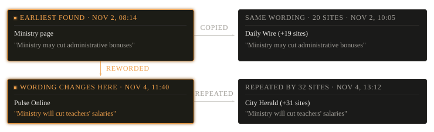

Factholic doesn't declare what is true. You paste a text, link, or video, and in about a minute it reconstructs the propagation path: the earliest publication found, who copied which version, and where the wording mutated. Because twenty sites copying a single page are still **one** source, not twenty confirmations.

*One rewrite at step two ("administrative bonuses" → "teachers' salaries") gets copied by 32 outlets.*

## What counts as a mutation

Along every edge of the tree, Factholic compares the structure of the claim in the parent and in the copy — not the wording. Synonyms, rounding and the same date written differently are ignored; what's left falls into a few recurring patterns:

| Pattern | Example |
|---|---|
| **Inflated numbers** | "2 injured" → "200 injured" |
| **Shifted time** | a story from 2021 resurfaces as "yesterday" |
| **Moved place** | "a warehouse near the market" → "the shopping mall" |
| **Raised certainty** | "may cut" → "will cut": a possibility becomes a fact |
| **Swapped attribution** | an anonymous post becomes "officials say" |

## What you get back

A long text or video usually holds several claims, so the report goes claim by claim and never adds them up into one score. Each claim gets:

- **a key finding** in one line, e.g. "the event is 3.5 years old, presented as yesterday's";
- **flags** for the patterns above, like *old content* or *inflated*;
- **the tree**: the earliest source found and every reprint, with the changed ones highlighted; open any link to see the two versions side by side;
- **where sources stand**: who confirms the claim, who refutes it, and whether they agree at all.

*The claim tree in the app: a warehouse becomes a shopping mall, two injured become 200, and the script repeats the inflated version.*
